# File-Store: Digital PDF Bookstore

File-Store is a Persian-first, right-to-left digital bookstore for PDF books. The storefront and admin panel are a **React 19 + TypeScript** single-page application. The **Laravel 12** API handles authentication, business rules, payments, and protected file downloads. The two parts communicate over JSON, with cookie-based session authentication through Laravel Sanctum.

Created by **Arash** · [GitHub profile](https://github.com/Arash-abraham) · [Repository](https://github.com/Arash-abraham/File-Store)

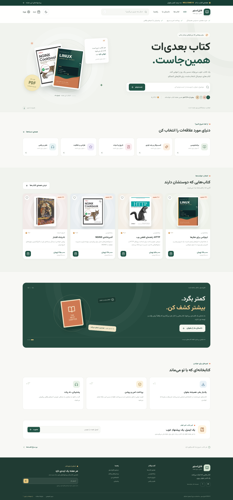

## Contents

- [Features](#features)
- [Architecture and flows](#architecture-and-flows)
- [Roles and access](#roles-and-access)
- [Tech stack](#tech-stack)
- [Requirements](#requirements)
- [Local setup](#local-setup)
- [Frontend demo mode](#frontend-demo-mode)
- [API overview](#api-overview)
- [Data model](#data-model)
- [Configuration](#configuration)
- [Security](#security)
- [Tests and checks](#tests-and-checks)
- [Production deployment](#production-deployment)
- [Troubleshooting](#troubleshooting)
- [Known limitations](#known-limitations)
- [Project structure](#project-structure)
- [Contributing](#contributing)
- [Authors](#authors)
- [Support](#support)

## Features

### Storefront

- Persian/RTL interface with Vazirmatn typography, a responsive layout, and light and dark themes. The theme follows the operating system preference on the first visit and is remembered afterwards.
- Home page, category pages, and product pages with ratings and reviews.
- Free sample-PDF previews on product pages, managed from each book’s admin editor, plus related-book recommendations based on category and reader ratings.
- Instant search suggestions and an advanced catalog search (price range, minimum rating, discount, availability, tags, and sorting). Applied filters are kept in the URL, so result pages can be shared.
- Product comments and questions and answers (Q&A):
  - Only buyers can post comments. Comments have an optional rating and there is no posting limit.
  - Any logged-in user can ask questions, reply to questions, and like questions or replies.
  - Comments, questions, and replies can include an image and can be edited by their author.
  - Every item needs admin approval before it is shown to the public. Editing an approved item sends it back to pending.
  - Authors see their own pending and rejected items with a status note. Rejected items can be edited and resubmitted.
- Owned books are never sold twice. The storefront marks them and hides the buy button, and the API refuses to add them to the cart or charge for them again.
- Print-on-demand: a directory of partner printing houses, a partnership contract form for printing houses, and per-book print orders with paper, binding, and quantity options. Each order can be priced with a quote before it is placed.
- Admin-editable static pages (for example, "About us") and FAQs.

### Customer account

- Registration, sign-in, sign-out, email verification, and password reset.
- Profile management, order history, a personal library, and protected downloads of purchased files.
- A personal favorites list; books saved before a price drop are highlighted in the list so customers can spot the new price.
- Cart with coupon codes and checkout. Customers pay from their wallet when the balance covers the full order, or through Zarinpal.
- Wallet top-up through Zarinpal (optional).
- Support tickets as a two-way conversation. Customers reply in the same thread, can write again on a closed ticket to reopen it, and see the status of each request.

### Admin dashboard

- **Task center:** a unified queue for open support tickets, pending reviews and questions, print orders awaiting confirmation, and print-house partnership requests. Filter and search the queue, approve/reject content, confirm print orders, and review partnership requests without switching sections.
- **Overview:** three Chart.js charts (daily sales, new users, and visits) and summary numbers for revenue, orders, users, open tickets, pending reviews, and visitors.
- **Users:** a searchable customer list. Selecting a customer shows their orders, lifetime spend, and support requests.
- **Support inbox:** filter tickets by status or customer, read the full thread, reply, change the status, or send a reply and close the ticket in one step.
- **Comments and Q&A moderation:** approve, reject, or delete comments, questions, and replies, filtered by status and type.
- **Catalog:** products, categories, tags, coupons, private product files, and cover images.
- **Content:** static pages, FAQs, navigation menus, and site settings.
- **Printing:** printing houses, contract requests, and print orders.
- **Payments:** the list of payment transactions and their status.

Visits are counted once per page change on the storefront. Each visit stores a daily salted hash of the visitor's IP address and user agent, so raw IP addresses are not stored. Admin pages are not counted.

## Architecture and flows

The diagrams below use Mermaid, so they render directly on GitHub and in most Markdown viewers.

### 1. System context

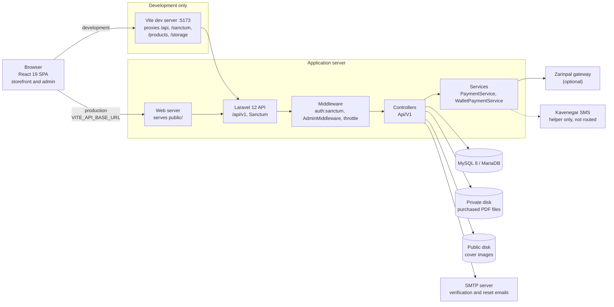

- In development, Vite proxies `/api`, `/sanctum`, `/products`, and `/storage` to Laravel, so the browser sees one origin.
- In production, the static bundle in `frontend/dist` calls the API domain directly, so the two must share a parent domain for cookie authentication.
- Business rules live only in the API. The React app never decides prices, ownership, or file access.
- Purchased files are never public URLs. They are read from the private disk only after the API confirms ownership.

### 2. Layers inside the API

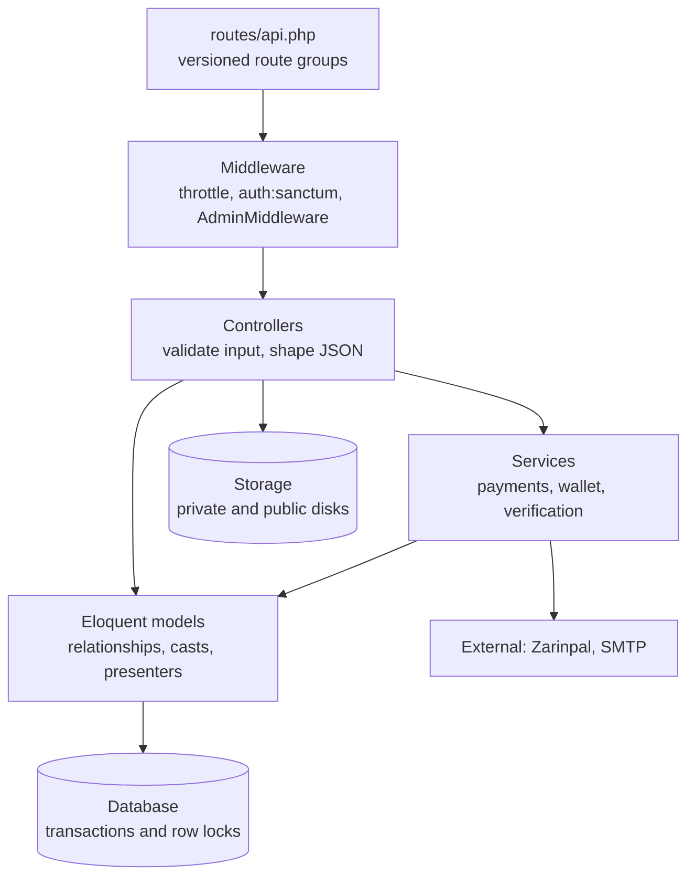

Controllers stay thin. Money-moving code runs inside database transactions with row locks (for example, the wallet is locked before a debit).

### 3. Request lifecycle

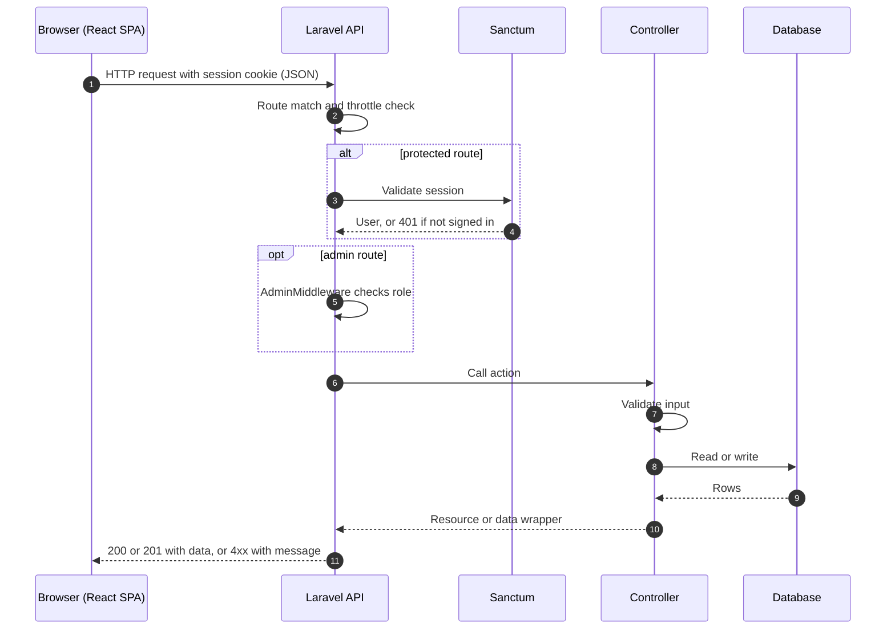

Successful responses are wrapped in `data`. Validation errors return 422 and the storefront shows the message.

### 4. Sign-in and session

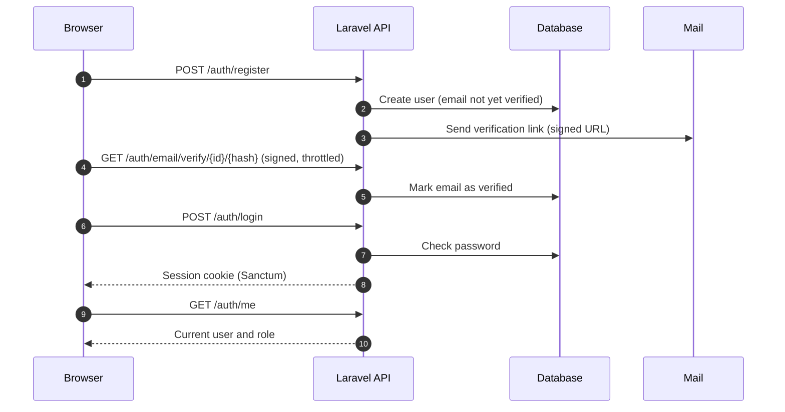

Password reset follows the same pattern through `POST /auth/forgot-password` and `POST /auth/reset-password`. Both are rate limited.

### 5. Checkout and payment

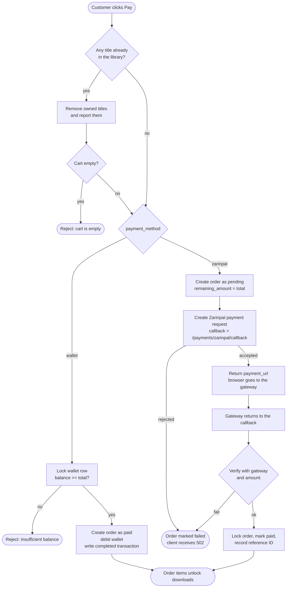

The wallet path is all or nothing: the balance must cover the whole order. Otherwise the customer pays through Zarinpal. Verification compares the amount that was requested with the amount the gateway confirms, and the order is locked during the update, so a repeated callback cannot charge or unlock twice.

### 6. Zarinpal payment, step by step

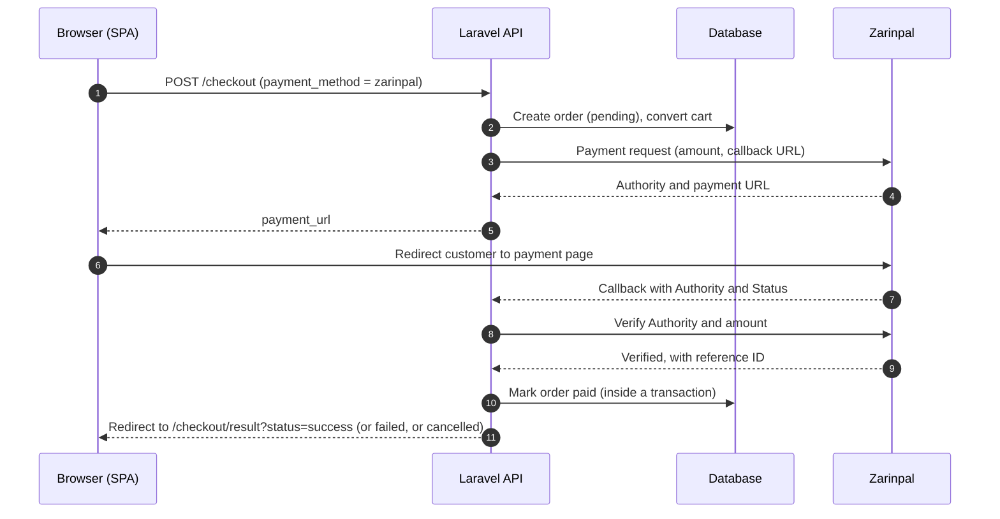

Wallet top-ups use the same pattern at `/wallet/zarinpal/callback`. Each top-up is a pending transaction that becomes completed only after verification, and the balance is incremented inside a locked transaction.

### 7. Protected download

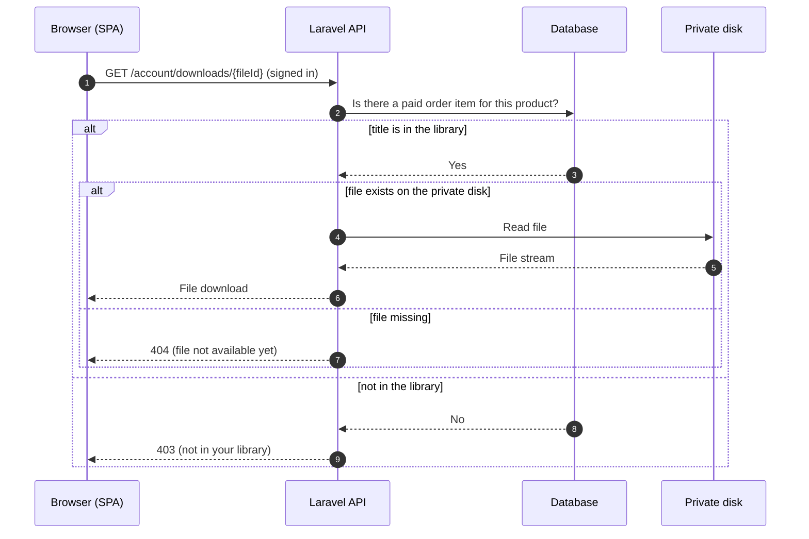

### 8. Comment and Q&A moderation

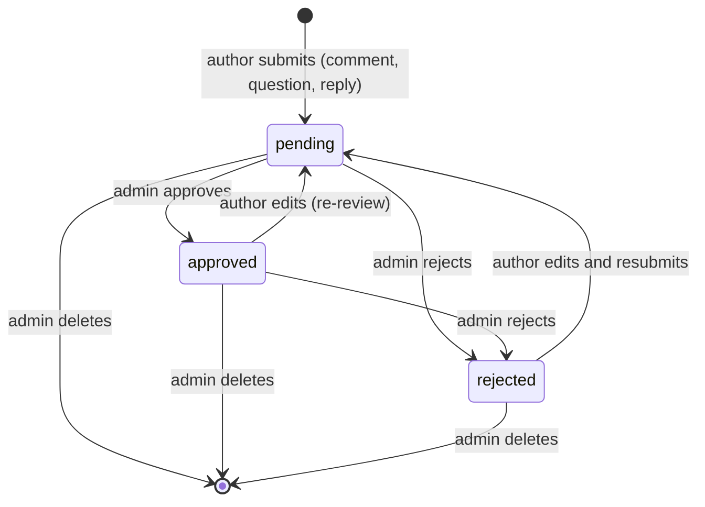

Only `approved` items are shown to other visitors. Authors can always see their own pending and rejected items with a status note. Editing an approved item sends it back to `pending`.

### 9. Support ticket lifecycle

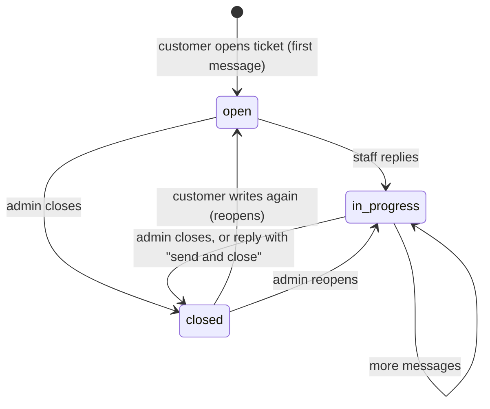

Every message is stored in `ticket_messages` with its author and whether it came from staff. Customers see only their own tickets.

### 10. Visit tracking

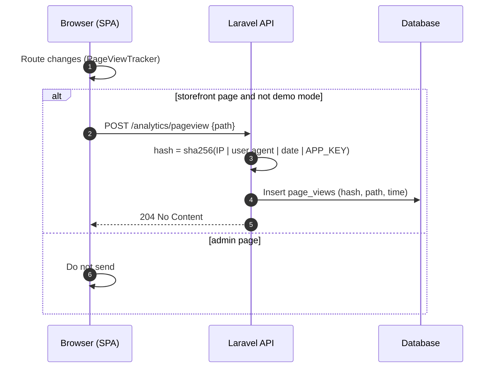

The hash changes every day and cannot be turned back into an IP address. The dashboard counts views per day and unique visitors per day from these rows.

### 11. Data model

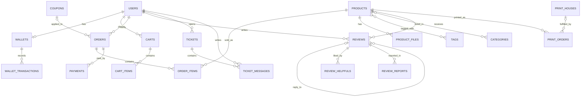

### 12. Deployment

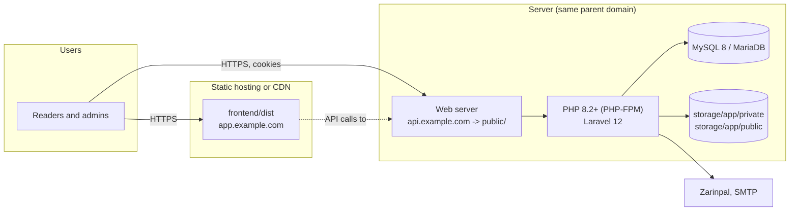

Keep `APP_KEY` stable across releases, set `SESSION_SECURE_COOKIE=true`, and host the SPA and the API under the same parent domain so Sanctum cookies work.

## Roles and access

| Role | What it can do |
|---|---|
| Guest | Browse the catalog, read product pages, search, read approved comments and Q&A, and view static pages and FAQs. |
| Customer (logged in) | Everything a guest can do, plus the cart, checkout, wallet, library, downloads, support tickets, and asking or answering questions. |
| Buyer | A customer with a paid order for the product. Only buyers can post product comments. |
| Admin | All `/api/v1/admin` routes: catalog, content, moderation, users, support, printing, and payments. Access is checked by `AdminMiddleware`. |

## Tech stack

| Layer | Technology |
|---|---|
| Backend | PHP 8.2+, Laravel 12, Laravel Sanctum (session-based SPA authentication) |
| Database | MySQL 8 / MariaDB |
| Frontend | React 19, TypeScript 5, Vite 7, React Router 7, TanStack Query 5 |
| Styling | Tailwind CSS 4 (via `@tailwindcss/vite`), custom CSS, Vazirmatn font |
| Icons | lucide-react |
| Charts | Chart.js 4 |
| HTTP clients | Axios (frontend), Guzzle (backend) |
| Persian dates | morilog/jalali, hekmatinasser/verta |
| Payments | Zarinpal via `pishran/zarinpal` (optional) |
| SMS | Kavenegar PHP SDK (helper service; see [Known limitations](#known-limitations)) |
| API documentation | Scramble (`dedoc/scramble`) |

## Requirements

- PHP 8.2 or newer, with Composer 2 and the extensions Laravel needs: PDO MySQL, cURL, Fileinfo, Mbstring, OpenSSL, and XML.
- MySQL 8 or MariaDB, with an empty database for the application.
- Node.js 20.19 or newer (or 22.12 or newer), with npm.

## Local setup

Run Laravel and Vite in two separate terminals. The default addresses are:

- API: `http://127.0.0.1:8000`
- React app: `http://localhost:5173`

### 1. Clone the repository

```bash
git clone https://github.com/Arash-abraham/File-Store.git
cd File-Store
```

### 2. Set up the Laravel API

From the repository root:

```bash
composer install
cp .env.example .env
php artisan key:generate
```

Create a database (for example `file_store`) and set its credentials in `.env`:

```env
DB_CONNECTION=mysql
DB_HOST=127.0.0.1
DB_PORT=3306
DB_DATABASE=file_store
DB_USERNAME=root
DB_PASSWORD=your_database_password
```

The local SPA and API settings are already in `.env.example`. If you change a port or host, keep these values in sync:

```env
APP_URL=http://127.0.0.1:8000
FRONTEND_URL=http://localhost:5173
CORS_ALLOWED_ORIGINS=http://localhost:5173,http://127.0.0.1:5173
SANCTUM_STATEFUL_DOMAINS=localhost:5173,127.0.0.1:5173,localhost:8000,127.0.0.1:8000
SESSION_DOMAIN=null
```

### 3. Create the schema and demo data

```bash
php artisan migrate --seed
php artisan storage:link
```

The seeders create sample users, categories, products, tags, coupons, product files, settings, FAQs, pages, menus, wallets, carts, orders, payments, support tickets, and reviews.

> **Upgrading an existing database?** Run `php artisan migrate` without `--seed`. The recent migrations add comment and Q&A fields to reviews, create the ticket message thread (existing tickets are copied into it as messages), and create the page view table. Nothing is seeded again.

Demo accounts (the values come from `DEMO_*` in `.env`):

| Role | Email | Default password |
|---|---|---|
| Customer | `user@example.com` | `password` |
| Admin | `admin@example.com` | `password` |

These accounts are for local development only. Change their passwords or remove them before deploying. `php artisan migrate:fresh --seed` **permanently deletes all data** in the database.

### 4. Start the API

```bash
php artisan serve --host=127.0.0.1 --port=8000
```

Health check: `http://127.0.0.1:8000/api/v1/health`

### 5. Start the React app

In a second terminal:

```bash
cd frontend
cp .env.example .env.local
npm ci
npm run dev
```

Open `http://localhost:5173`. To send API calls to a different host or port, set `API_PROXY_TARGET` in `frontend/.env.local`.

## Frontend demo mode

You can explore the storefront and the admin panel without running Laravel. In `frontend/.env.local`:

```env
VITE_DEMO_MODE=true
```

Restart Vite, then sign in with either demo email and the password `password`. The demo cart is stored in `localStorage`. Checkout, comments, questions, tickets, and admin changes in demo mode are local simulations. No payment is made and nothing is saved on a server. Set `VITE_DEMO_MODE=false` to use the real API.

## API overview

All endpoints are under `/api/v1`. Successful responses are wrapped in a `data` property. Interactive API documentation is generated by Scramble at `/docs/api` when it is enabled.

| Group | Endpoints (examples) |
|---|---|
| Public storefront | `GET /home`, `/products`, `/products/{slug}`, `/products/{slug}/preview` (when a sample is available), `/products/{slug}/reviews`, `/search/suggest`, `/categories`, `/faqs`, `/pages/{slug}`, `/print-houses`, `/navigation`, `/settings` |
| Analytics | `POST /analytics/pageview` (rate limited) |
| Authentication | `POST /auth/register`, `/auth/login`, `/auth/logout`, `/auth/forgot-password`, `/auth/reset-password`; `GET /auth/me` |
| Cart and checkout | `GET /cart`; `POST /cart/items`, `/cart/coupon`, `/checkout`; `PATCH` and `DELETE /cart/items/{itemId}`; `DELETE /cart/coupon` |
| Account | `GET` and `PUT /account/profile`; `GET /account/overview`, `/account/library`, `/account/orders`, `/account/downloads`, `/account/favorites`, `/account/print-orders`, `/account/tickets`; `GET /account/tickets/{ticket}`; `POST /account/tickets`; `POST /account/tickets/{ticket}/messages` |
| Favorites | `GET /account/favorites`; `POST` and `DELETE /favorites/{productId}` (authenticated) |
| Reviews, comments, and Q&A | `POST /reviews` (comments, questions, and replies); `POST /reviews/{review}/edit`; `POST /reviews/{review}/helpful`; `POST /reviews/{review}/report` |
| Wallet | `GET /wallet`; `POST /wallet/deposits` |
| Printing | `POST /print-houses/contract-requests`; `POST /print-orders/quote`; `POST /print-orders` |
| Administration | `/admin/dashboard`, `/admin/users`, `/admin/users/{id}`, `/admin/tickets`, `/admin/tickets/{id}`, `/admin/tickets/{id}/messages`, `PUT /admin/tickets/{id}`, `/admin/reviews`, `/admin/products` (including `POST`/`DELETE /admin/products/{id}/preview`), `/admin/categories`, `/admin/tags`, `/admin/coupons`, `/admin/faqs`, `/admin/pages`, `/admin/menus`, `/admin/payments`, `/admin/print-houses`, `/admin/print-contracts`, `/admin/print-orders`, `/admin/settings` |

### Rules the API enforces

- **Owned books:** `POST /cart/items` rejects a title that is already in the library or the cart. `POST /checkout` removes any owned titles it finds and reports them before charging.
- **Downloads:** download endpoints check for a paid order before they serve a private file.
- **Admin access:** every `/admin` route requires a Sanctum session for a user with the admin role.
- **Moderation:** comments, questions, and replies are visible to the public only after an admin approves them. The author can always see their own pending and rejected items.
- **Comments:** only buyers can post comments. Questions and replies are open to any logged-in user.
- **Support tickets:** a customer can read and reply only to their own tickets. Any reply on a closed ticket reopens it.

### Catalog filters

`GET /products` accepts `q`, `category`, `tag`, `price_min`, `price_max`, `min_rating`, `on_sale`, `has_files`, and `sort`. Valid `sort` values are `popular`, `newest`, `rating`, `discount`, `price_asc`, and `price_desc`. The filters that were applied are returned in `meta.filters`.

## Data model

The main tables and models:

| Area | Tables and models |
|---|---|
| Accounts | `users`, `wallets`, `wallet_transactions`, `verification_codes`, `otp_codes` |
| Catalog | `products`, `product_files`, `product_tag`, `category_product`, `categories`, `tags`, `coupons` |
| Shopping | `carts`, `cart_items`, `orders`, `order_items`, `payments` |
| Community | `reviews` (type, status, rating, parent, image), `review_helpfuls`, `review_reports` |
| Support | `tickets` (status: `open`, `in_progress`, `closed`), `ticket_messages` |
| Content | `pages`, `faqs`, `menus`, `web_settings` |
| Printing | `print_houses`, `print_contract_requests`, `print_orders` |
| Analytics | `page_views` (daily salted visitor hash, path, timestamp) |

## Configuration

### Key environment variables

| Variable | Purpose |
|---|---|
| `APP_URL`, `FRONTEND_URL` | Base URLs. `FRONTEND_URL` is used for payment returns and password-reset links. |
| `CORS_ALLOWED_ORIGINS`, `SANCTUM_STATEFUL_DOMAINS`, `SESSION_DOMAIN` | Cookie authentication between the React app and the API |
| `SESSION_SECURE_COOKIE` | Set to `true` in production over HTTPS |
| `DB_*` | MySQL connection |
| `MAIL_*` | Email for verification and password reset. `MAIL_MAILER=log` writes to the log for local use. |
| `ZARINPAL_MERCHANT_ID`, `ZARINPAL_SANDBOX` | Zarinpal gateway (optional) |
| `DEMO_USER_*`, `DEMO_ADMIN_*` | Seeder accounts |
| `VITE_DEMO_MODE`, `VITE_API_BASE_URL` | Frontend build settings |
| `API_PROXY_TARGET` | Development proxy target for Vite (defaults to `http://127.0.0.1:8000`) |

### Email

Set SMTP settings in `.env` to deliver verification and password-reset emails. The default `MAIL_MAILER=log` writes messages to the Laravel log instead of sending them.

### Zarinpal

Set `ZARINPAL_MERCHANT_ID` and keep `ZARINPAL_SANDBOX=true` until you are ready for production. Without a merchant ID, payment initiation fails, but the rest of the store still works, and wallet payments and demo mode are unaffected.

### Files

- Cover images can be served from the public disk.
- Purchased files are stored on the **private** disk. They are served only through the authenticated download endpoint, after the API checks for a paid order.
- The seeded text files are small test fixtures, not real books.

## Security

- **Authentication:** Sanctum session cookies for the SPA. Protected routes use `auth:sanctum`.
- **Authorization:** admin routes are protected by `AdminMiddleware`. Customers can access only their own orders, tickets, and downloads.
- **Rate limiting** on sensitive routes, including:
  - Login: 8 requests per minute.
  - Registration: 6 per minute.
  - Forgot and reset password: 5 per minute.
  - Wallet deposits: 5 per minute.
  - Ticket replies: 20 per minute.
  - Page view tracking: 120 per minute.
- **Private files:** product files never have public URLs.
- **Visitor privacy:** analytics stores only a daily salted hash, not the IP address.
- **Moderation:** user content is hidden until approved.
- **Production hardening:** keep `APP_DEBUG=false`, never enable demo mode or the demo accounts on a public server, and use HTTPS with secure cookies.

## Tests and checks

```bash
# Frontend (from frontend/)
npm run typecheck
npm run build

# Backend (from the repository root, requires PHP and a configured test database)
php artisan test
php artisan route:list --path=api/v1
```

`npm run build` runs the TypeScript check and then the Vite production build.

## Production deployment

### Frontend

```bash
cd frontend
npm ci
npm run typecheck
npm run build
```

Upload `frontend/dist` to any static host or CDN. Set these variables before the build:

```env
VITE_API_BASE_URL=https://api.example.com/api/v1
VITE_DEMO_MODE=false
```

### API

```bash
composer install --no-dev --optimize-autoloader
php artisan migrate --force
php artisan storage:link
php artisan config:cache
php artisan route:cache
```

- Point the web server at Laravel's `public/` directory.
- Keep the same `APP_KEY` across releases. Do not regenerate it on an existing installation, because that breaks encrypted data and sessions.
- Host the frontend and the API under the same parent domain, for example `app.example.com` and `api.example.com`. Set `CORS_ALLOWED_ORIGINS` to the exact frontend origin, add both hostnames to `SANCTUM_STATEFUL_DOMAINS`, set `SESSION_DOMAIN` to the parent domain, and set `SESSION_SECURE_COOKIE=true`.
- Never enable `VITE_DEMO_MODE`, `APP_DEBUG=true`, or the demo accounts on a public server.

## Troubleshooting

| Problem | What to check |
|---|---|
| Login works but the session is lost, or requests return 401 or 419 | `SANCTUM_STATEFUL_DOMAINS`, `CORS_ALLOWED_ORIGINS`, and `SESSION_DOMAIN` must match the origins you use. Restart `php artisan serve` after changing `.env`. |
| Cover images or downloads are broken | Run `php artisan storage:link`. Check that the file exists on the private or public disk. |
| Emails do not arrive | Check the `MAIL_*` values. With `MAIL_MAILER=log`, messages are written to `storage/logs`. |
| Zarinpal payment fails | Confirm `ZARINPAL_MERCHANT_ID`, the sandbox setting, and that `FRONTEND_URL` is correct. |
| New admin sections are empty | Run `php artisan migrate`. Comments, Q&A, support threads, and visit tracking need the newer tables. |
| The React app shows demo data | Check `VITE_DEMO_MODE` in `frontend/.env.local`, then restart Vite. |
| Vite cannot reach the API | Confirm the API is running on the address in `API_PROXY_TARGET`. |

## Known limitations

- **SMS sign-in is not active.** A Kavenegar helper and verification-code models exist, but no SMS login or verification route is registered. Sign-in uses email and password.
- **Demo mode is a simulation.** Checkout, comments, tickets, and admin actions in demo mode do not reach the server.
- **Automated tests for the newest features are still missing.** Ticket threads, the visit tracker, and comment moderation are covered by manual checks and type checking, not by feature tests.
- **Chart data depends on real activity.** Visit charts start filling only after the new `page_views` table exists and storefront traffic is recorded.

## Project structure

```text
app/Http/Controllers/Api/V1/   API controllers (account, admin, analytics, storefront, wallet, ...)
app/Http/Middleware/           Admin access middleware
app/Models/                    Eloquent models (Review, Ticket, TicketMessage, Order, Wallet, ...)
app/Services/                  Payments, wallet payments, SMS helper
resources/views/emails/         Transactional email templates
routes/api.php                 Versioned API routes
database/migrations/           Schema history
database/seeders/              Base and demo records
frontend/src/pages/            Storefront, account, product, and admin pages
frontend/src/components/       Shared UI, admin charts and panels, support threads
frontend/src/index.css         Storefront and admin styles
docs/screenshots/              Screenshots used in this README
```

## Contributing

1. Create a branch from `main`.
2. Make your change and keep it focused.
3. Run `npm run typecheck` and `npm run build` in `frontend/`, and `php artisan test` in the repository root.
4. Open a pull request that describes the change, any migrations it adds, and any new environment variables.

## Authors

<div align="left">

| **Arash Ebrahimian** | **Amir Hossein Hosseinzade** |
|:--------------------:|:--------------------:|
|  |  |
| *Lead Developer & Project Architect* | *Co-developer & Template Specialist* |
| [](https://github.com/Arash-abraham) | [](https://github.com/iamhosseinzadeh) |

</div>

## Acknowledgments

- [Zarinpal](https://zarinpal.com) for the payment gateway.
- [Kavenegar](https://kavenegar.com) for the SMS SDK.

## Support

For questions or bug reports, email **arashebi777@gmail.com**.
