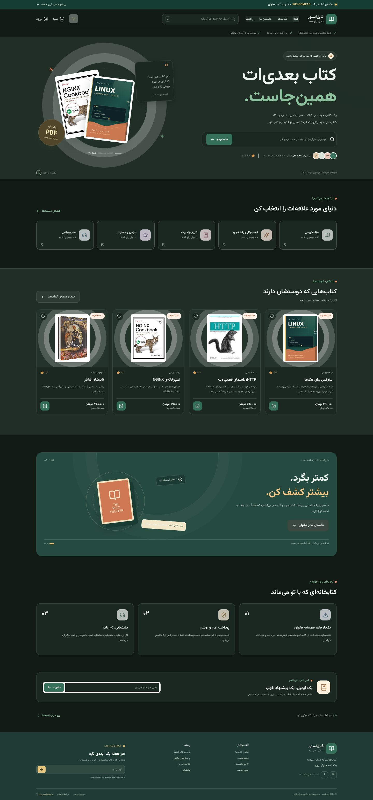

# File-Store — Digital Bookstore

File-Store is a Persian-first, right-to-left digital bookstore. The storefront is a standalone **React 19 + TypeScript + Vite** application; **Laravel 12 provides the API and server-side business logic only**. The storefront is not rendered with Blade or Inertia.

**Created by Arash** · [GitHub profile](https://github.com/Arash-abraham) · [Project repository](https://github.com/Arash-abraham/File-Store)

## Storefront preview

The screenshot below shows the storefront in demo mode.


## Features

- Persian/RTL storefront with a responsive layout and Vazirmatn typography.
- Light and dark themes, with system-preference detection and a persistent theme toggle.
- Home page, category browsing, search, product detail pages, ratings, and reviews.
- Authenticated cart, coupon codes, checkout, wallet payments, and optional Zarinpal integration.
- Customer accounts, order history, personal library, protected downloads, and support tickets.
- Registration, session-based sign-in, sign-out, email verification, password reset, and password change.
- Admin dashboard for products, private product files, support tickets, and review moderation.
- Optional frontend demo mode for exploring the UI without a running Laravel API.

## Technology

| Area | Stack |
|---|---|
| API | PHP 8.2+, Laravel 12, Laravel Sanctum |
| Database | MySQL 8 / MariaDB |
| Frontend | React 19, TypeScript, Vite 7, React Router, TanStack Query |
| Payments | Zarinpal (optional for local development) |

## Requirements

- PHP 8.2 or newer, Composer 2, and the PHP extensions required by Laravel (including PDO MySQL, cURL, Fileinfo, Mbstring, OpenSSL, and XML).
- MySQL 8 or MariaDB, with a database created for the application.
- Node.js 20.19+ or 22.12+ and npm.
- A terminal with `cp` support, or the equivalent file-copy command for your operating system.

## Local setup

Run Laravel and Vite in separate terminals. The default development addresses are `http://127.0.0.1:8000` for the API and `http://localhost:5173` for the React app.

### 1. Clone the repository

```bash
git clone https://github.com/Arash-abraham/File-Store.git
cd File-Store
```

### 2. Install and configure the Laravel API

From the repository root:

```bash
composer install
cp .env.example .env
php artisan key:generate
```

Create a database (for example, `file_store`) and set its credentials in `.env`:

```env
DB_CONNECTION=mysql
DB_HOST=127.0.0.1
DB_PORT=3306
DB_DATABASE=file_store
DB_USERNAME=root
DB_PASSWORD=your_database_password
```

The default local SPA/API settings are already in `.env.example`. If you use the default ports, keep these values aligned between Laravel and Vite:

```env
APP_URL=http://127.0.0.1:8000
FRONTEND_URL=http://localhost:5173
CORS_ALLOWED_ORIGINS=http://localhost:5173,http://127.0.0.1:5173
SANCTUM_STATEFUL_DOMAINS=localhost:5173,127.0.0.1:5173,localhost:8000,127.0.0.1:8000
SESSION_DOMAIN=null
```

If you change the frontend port or host, update `FRONTEND_URL`, `CORS_ALLOWED_ORIGINS`, and `SANCTUM_STATEFUL_DOMAINS` to match. The frontend origin must be allowed by Laravel for Sanctum cookie-based authentication.

### 3. Create the schema and seed demo data

```bash
php artisan migrate --seed
php artisan storage:link
```

The seeders create related sample records for users, categories, products, tags, coupons, product files, settings, FAQs, navigation, wallets, carts, orders, payments, support tickets, and reviews. The sample product files are stored on the private disk; purchased files are served through an authorized API endpoint.

The sample accounts are configurable with `DEMO_USER_EMAIL`, `DEMO_USER_PASSWORD`, `DEMO_ADMIN_EMAIL`, and `DEMO_ADMIN_PASSWORD` in `.env`:

| Role | Email | Default password |
|---|---|---|
| Customer | `user@example.com` | `password` |
| Admin | `admin@example.com` | `password` |

These credentials are for local development only. Change them or remove the demo users before deploying. To rebuild the database from scratch, run `php artisan migrate:fresh --seed`; **this permanently deletes existing database data**.

### 4. Start the Laravel API

In the first terminal, from the repository root:

```bash
php artisan serve --host=127.0.0.1 --port=8000
```

The API health check is available at `http://127.0.0.1:8000/api/v1/health`. The root URL returns a JSON service response; it does not render a web storefront.

### 5. Install and start the React app

In a second terminal:

```bash
cd frontend
cp .env.example .env.local
npm ci
npm run dev
```

Open `http://localhost:5173`. In development, Vite proxies `/api`, `/sanctum`, `/products`, and `/storage` requests to `http://127.0.0.1:8000`. To use a different Laravel host or port, set `API_PROXY_TARGET` in `frontend/.env.local`, for example:

```env
API_PROXY_TARGET=http://127.0.0.1:8000
```

## Frontend demo mode

You can preview the React storefront without starting Laravel. In `frontend/.env.local`, set:

```env
VITE_DEMO_MODE=true
```

Then restart Vite. Demo users can sign in with either sample email above and the password `password`. The demo cart is stored in `localStorage`; demo checkout and changes are local simulations, not real payments or server-side transactions. Set `VITE_DEMO_MODE=false` to use the Laravel API.

## Theme preferences

Use the sun/moon control in the header to switch between light and dark themes. On the first visit, the app follows the operating system's color preference; the selected theme is then saved in browser storage and restored on subsequent visits.



## API overview

All API v1 endpoints are under `/api/v1`. Successful JSON responses are generally wrapped in a `data` property.

| Group | Endpoints |
|---|---|
| Public storefront | `GET /health`, `/home`, `/products`, `/products/{slug}`, `/categories`, `/faqs`, `/navigation`, `/settings` |
| Authentication | `POST /auth/register`, `/auth/login`, `/auth/forgot-password`, `/auth/reset-password`; `GET /auth/me`; `POST /auth/logout` |
| Cart and checkout | `GET /cart`; `POST /cart/items`, `/cart/coupon`, `/checkout`; `PATCH /cart/items/{itemId}`; `DELETE /cart/items/{itemId}`, `/cart/coupon` |
| Account | `GET/PUT /account/profile`; `GET /account/overview`, `/account/orders`, `/account/downloads`, `/account/tickets`; `POST /account/tickets` |
| Wallet and reviews | `GET /wallet`; `POST /wallet/deposits`, `/reviews`, `/reviews/{review}/helpful`, `/reviews/{review}/report` |
| Administration | `/admin/dashboard`, `/admin/products`, `/admin/categories`, `/admin/tags`, `/admin/coupons`, `/admin/faqs`, `/admin/menus`, `/admin/tickets`, `/admin/reviews`, `/admin/payments`, `/admin/settings` |

Admin endpoints require an authenticated Sanctum session with the `admin` role. Download endpoints verify access to a paid order before serving private product files. API documentation is available at `/docs/api` when the Scramble package is enabled.

## Production deployment

### Build and host the frontend

```bash
cd frontend
npm ci
npm run typecheck
npm run build
```

The static production bundle is written to `frontend/dist`. Host it on a static web server or CDN. Set frontend build variables before running `npm run build`:

```env
VITE_API_BASE_URL=https://api.example.com/api/v1
VITE_DEMO_MODE=false
```

### Deploy the Laravel API

Deploy the Laravel application independently and configure the production database and HTTPS. On the initial deployment, provision a secure `APP_KEY` (for a new installation, `php artisan key:generate` can create it). Then run:

```bash
composer install --no-dev --optimize-autoloader
php artisan migrate --force
php artisan storage:link
```

Do not generate a new `APP_KEY` on each release; preserve the same secret for an existing installation. Configure the production web server to point to Laravel's `public/` directory and apply the normal Laravel production hardening steps.

For Sanctum cookie authentication, host the frontend and API on the same top-level domain (for example, `app.example.com` and `api.example.com`). Set `CORS_ALLOWED_ORIGINS` to the exact frontend origin, include both hostnames in `SANCTUM_STATEFUL_DOMAINS`, and configure `SESSION_DOMAIN` for the parent domain. Enable secure cookies over HTTPS with `SESSION_SECURE_COOKIE=true`. `FRONTEND_URL` is also used for payment returns and password-reset links.

Never enable `VITE_DEMO_MODE` in production. Do not expose demo passwords, API secrets, payment credentials, or `APP_DEBUG=true` on a public deployment.

## Optional services and file storage

### Email

For local development, `MAIL_MAILER=log` writes outgoing messages to the Laravel log. Configure SMTP in `.env` to deliver verification and password-reset messages to real inboxes.

### Zarinpal

Set `ZARINPAL_MERCHANT_ID` and choose the appropriate sandbox/production setting with `ZARINPAL_SANDBOX`. Payment initiation requires valid gateway configuration; the UI can still be explored in demo mode without a gateway.

### Files

Public product covers can be served from the public storage disk or `public/products`. Purchased product files must remain on the private disk and be served only through the authenticated download endpoint. Seeded text files are small test fixtures, not the actual books.

## Tests and checks

Frontend checks:

```bash
cd frontend
npm run typecheck
npm run build
```

Laravel tests and route inspection (requires PHP, Composer dependencies, and a configured test database):

```bash
php artisan test
php artisan route:list --path=api/v1
```

## Project structure

```text
app/Http/Controllers/Api/V1/    Laravel API controllers
app/Http/Resources/Api/V1/      JSON resources
routes/api.php                  Versioned API routes
routes/web.php                  JSON service response; no UI rendering
database/seeders/               Base and demo records
frontend/src/                   Standalone React/TypeScript application
frontend/public/images/books/   Local demo book covers
docs/screenshots/               Storefront screenshots
```

## About the creator

File-Store is created by **Arash**. Visit [Arash's GitHub profile](https://github.com/Arash-abraham) or browse the [File-Store repository](https://github.com/Arash-abraham/File-Store).
